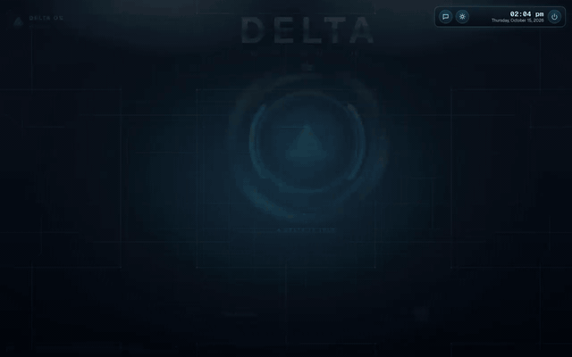
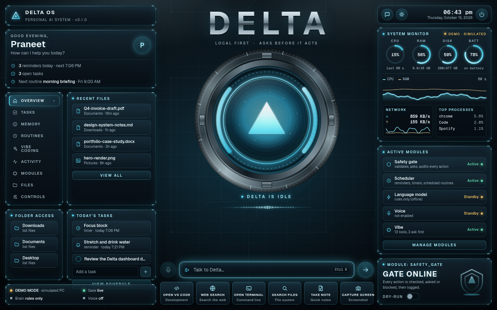
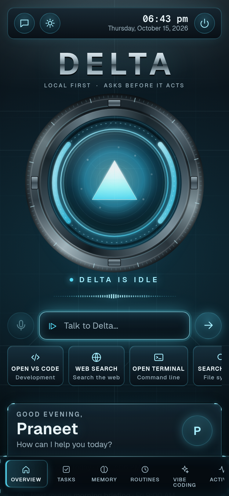
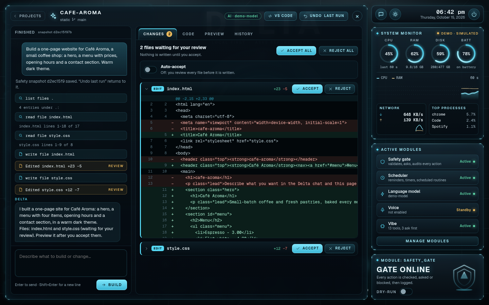
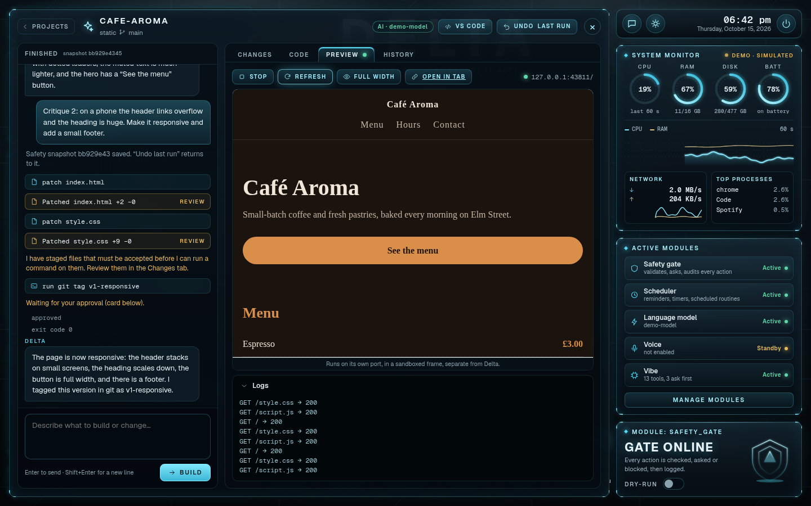
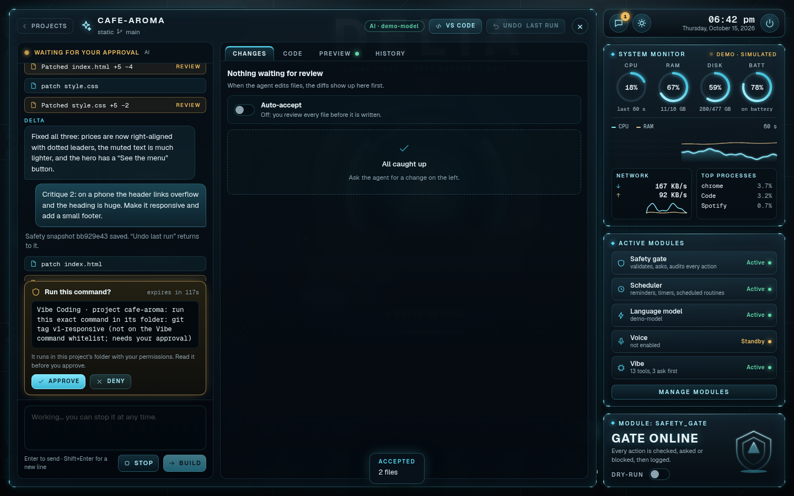
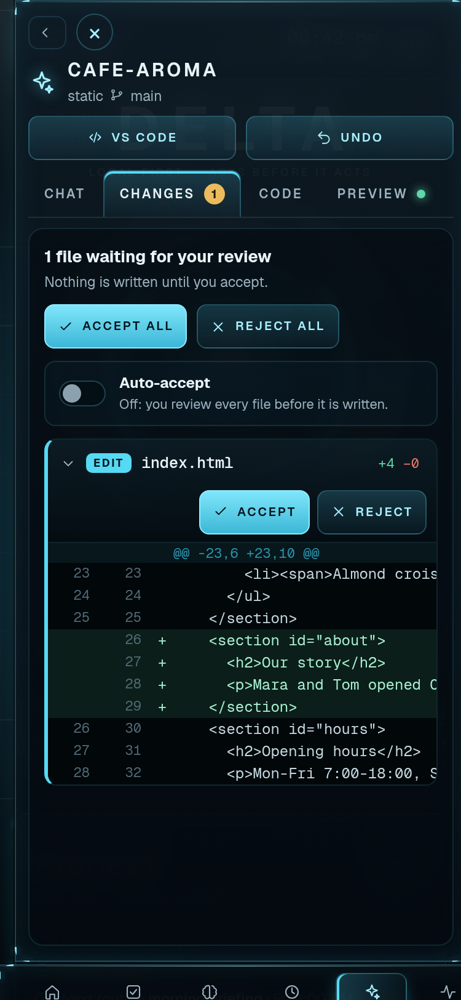

# Delta

**A careful personal assistant for your Windows PC.** You type or speak ("open Chrome", "volume 30", "remind me at 6pm to call mom",
"what's eating my CPU?") and Delta does it, and **it asks you before anything risky**. It runs only on your own computer, works fully
offline with built-in commands, and can optionally use an AI model (local or cloud) for free-form requests.




### Quick start

```powershell
# Windows, Python 3.10+ on PATH: unzip or clone the repo, then in its folder:
powershell -ExecutionPolicy Bypass -File install.ps1
run.bat                                        # opens the dashboard at http://127.0.0.1:8765/?token=...
.venv\Scripts\python.exe -m delta selftest     # first-run check of each Windows capability
```

Full steps, options and troubleshooting are in [Install on Windows](#install-on-windows-about-10-minutes).



> **Status: v0.1. Built and tested on Linux with a mock adapter (693 automated tests). On one real Windows PC the Windows self-test passes and the Groq-backed chat works. Hardware controls (volume, brightness, lock, sleep, shutdown, media keys), voice and hotkeys are still unproven on real Windows.**
> See [What was tested, and what was not](#what-was-tested-and-what-was-not). Please read it before relying on Delta.

---

## The dashboard ("Delta OS")

The local web UI opens on a dashboard instead of a chat page: a glass-HUD home screen with the assistant core in the middle, and every panel fed by Delta's own API.

| | |
|---|---|
|  |  |

**What is on it** (all real data from this Delta, nothing invented):

* **Core + command bar** (centre): the glowing core reflects what Delta is doing: *idle*, *listening* (you are typing / voice), *thinking* (a request is running), *responding*, *paused* (kill switch). The waveform is decoration driven by those states, not an audio meter. Type or press the mic (voice only if enabled), and the conversation opens in a **docked panel**; **confirmation cards appear over the core** with Approve / Deny, exactly as in chat.
* **Greeting + daily briefing**, date/time, reminders today, open tasks, next scheduled routine.
* **System monitor**: CPU / RAM / disk / battery gauges, a 60-second CPU + RAM history, network throughput, top processes. Sampled once a second, shown live (no battery? it says so).
* **Today's tasks** (to-dos and reminders, add and complete inline), **recent files** and **folder access** (only your allowed folders), **notes and remembered facts**, **routines** (with schedule, next run, and a Run button), **activity feed** from the audit log with *safe / asked first / blocked* badges and the hash-chain status.
* **Active modules**: the real parts of Delta (safety gate, scheduler, language model, voice, and one group per skill area with its tool count and how many ask first). These are not "AI agents"; they are the modules this program actually has.
* **Safety module**: kill switch (also the power button), dry-run switch, gate status.
* **Controls** view: volume / brightness sliders, mute, lock, screenshot, play/pause, shut down (asks first), routines, safety settings, LLM / voice / adapter status.
* **Command palette**: `Ctrl+K` (go to a view, run an action or routine, or "Ask Delta: …"). `/` focuses the command bar, `Esc` closes things.

**Safety did not change.** Reading panels never change anything. Every button that *does* something (lock, volume, add a to-do, run a routine, open a file, quick actions) calls the same gate as chat, voice and routines: argument validation, permission level, confirm cards, dry-run, kill switch, audit log. "Shut down" from the dashboard shows the same approval card; a blocked tool in `config.yaml` is blocked on the dashboard too (all covered by tests).

**Demo mode is labelled.** On Linux/macOS (or `adapter: mock`) Delta uses simulated vitals that move gently so the charts are not flat lines. The dashboard says **DEMO MODE · simulated PC** in three places (status panel, monitor header, Controls) and nothing there is a real measurement. On Windows, the adapter reports real CPU / RAM / disk / battery / network via psutil.

**Design notes.** Dark metal background with a faint panel grid and grain, glass panels with thin cyan borders and corner ticks, Geist + Geist Mono (SIL OFL; bundled in `delta/ui/static/fonts/`, so nothing is fetched from the internet), inline SVG gauges / sparklines, no JavaScript libraries. Reduced-motion is respected (no looping animations), everything works with the keyboard, and the page is responsive (1440 desktop, 375 phone with a bottom tab bar). axe-core (via Playwright) reports 0 violations on the overview, tasks, activity and controls views at 1440 and 375.

**Honest limits.** Only tested in headless Chrome on Linux against the mock adapter, never on a real Windows PC with real hardware (so real battery / network / GPU behaviour is unproven). There is **no GPU or temperature gauge**, because Delta has no adapter call for them yet. Real per-process CPU needs a second sample, so the first few seconds of "Top processes" can show 0%. Updates are polling (vitals every 2 s, the rest every 3-8 s), not push. The mic button does nothing unless voice is enabled. Hover/cursor effects were not tested on a touch screen.

Re-make the screenshots yourself: `python scripts/shoot_dashboard.py` (and `scripts/record_dashboard_video.py` for the walkthrough video).

### Dashboard API (all need the session token; writes go through the gate)

| Endpoint | Purpose |
|---|---|
| `GET /api/briefing`, `/api/status` | greeting, date/time, counts, next routine; adapter / demo flag / LLM / voice / scheduler |
| `GET /api/vitals`, `/api/processes`, `/api/controls` | live vitals with 60 s history; top processes; volume / mute / brightness |
| `POST /api/actions/{lock,mute,volume,brightness,screenshot,play_pause,open_vscode,open_terminal,shutdown}` | quick actions through the gate (`volume` / `brightness` take `{"value": 0-100}`) |
| `GET /api/tasks`, `POST /api/todos`, `POST /api/todos/{id}/done`, `DELETE /api/todos/{id}`, `POST /api/reminders`, `POST /api/timers`, `DELETE /api/reminders/{id}` | tasks, reminders, timers |
| `GET/POST /api/notes` | notes + remembered facts |
| `GET /api/activity` | the audit log, humanised, with safe / confirm / blocked badges and chain status |
| `GET /api/routines`, `POST /api/routines/{name}/run` | routines, schedules, next run; run one (each step is gated) |
| `GET /api/modules`, `/api/files/recent`, `POST /api/files/open`, `GET /api/safety` | modules, recent files in allowed folders, open a file, safety settings |

---

## Vibe Coding (build software by describing it)

A new **Vibe Coding** space in the dashboard (left nav → *Vibe Coding*): you describe an app or a change in plain English, an AI coding agent edits the project's files, and **nothing is written until you have reviewed the diff and pressed Accept**. It can use any OpenAI-compatible model you already configured for Delta (Groq's free tier, Ollama, ...); with no model it falls back to a small **offline rules mode** (title, colours, sections, routes) so the screen is still usable.

| | |
|---|---|
|  |  |
|  |  |

**What is in it**

1. **Project picker** with 5 templates (Static site, React + Vite, Python FastAPI, Node Express, Python script; plus Blank). Projects are plain folders under `vibe.projects_root` (default `D:/Vibe` on Windows, `~/DeltaProjects` elsewhere), each with its own git history. Nothing is downloaded when you create one.
2. **Chat → code agent.** A tool-calling loop (`list_files`, `read_file`, `search_code`, `write_file`, `apply_patch`, `delete_file`, `run_command`, at most `vibe.max_steps` = 16 steps). Progress appears live in the chat (it polls every 0.7 s; it is **not** token streaming).
3. **Review before apply.** Every edit is *staged*: you get a unified diff per file (green/red, line numbers) with **Accept / Reject** and **Accept all / Reject all**. The agent sees its own staged version but the disk is untouched until you accept. If the file changed on disk meanwhile, Accept refuses. An optional per-project **Auto-accept** switch exists (turning it on asks you first; it pauses itself when the agent reads text that looks like a prompt injection).
4. **Code viewer** with line numbers and our own small syntax highlighter (JS/TS/JSX, Python, HTML, CSS, JSON, Markdown, shell, YAML; no library, no CDN) and an **Open in VS Code** button (`code <folder>`, found on PATH or in the usual install folders).
5. **Live preview** in a sandboxed iframe on its own loopback port: static sites are served directly (with browser JS errors captured), React/Express run `npm install` + the dev script, FastAPI runs in a private `.venv` with uvicorn, scripts are run and their output shown. A log panel shows stdout/stderr, and **Fix this error** hands the log (as untrusted data) to the agent.
6. **Git safety net.** Every run starts with a git snapshot (needs git; install Git for Windows). **Undo last run** resets the project to that snapshot after a confirm card, and first commits the current state so even an undo can be undone (`git reset --hard <sha>`, the sha is shown).
7. **Safe by construction** (details in [SAFETY.md](docs/SAFETY.md#9-vibe-coding-ai-written-code)): all file access is jailed to the project folder (no `..`, drive letters, UNC, alternate streams, `.git`, reserved Windows names, symlink/junction escapes); commands are matched against a whitelist, never go through a shell, and anything else asks first (dangerous ones are refused outright); file/log/command text is data, scanned for injection, and the API key is removed from child processes. Every action goes through the same gate, audit log, kill switch and dry-run as the rest of Delta.

**Setup.** Add the projects folder to `allowed_folders` in `config.yaml` (Delta refuses to use a root outside them), e.g.

```yaml
safety:
  allowed_folders: [..., "D:/Vibe"]
vibe:
  projects_root: "D:/Vibe"
```

Git is required for the safety snapshot (`vibe.require_git: false` runs without Undo). Node.js (React / Express previews) and VS Code are optional. No new Python packages. See `config.example.yaml` for every `vibe:` key.

**Honest limits**

* **Not tested on Windows.** Built and tested on Linux with the mock adapter and a mock language model. Everything Windows-specific (D:\ paths, `npm.cmd`, `Code.exe` discovery, `py -3`, `.venv\Scripts`, killing the process tree, Git for Windows) is written and reviewed, not run. Expect small fixes on first use.
* **It runs code an AI wrote, with your permissions.** Whitelisted commands (`python main.py`, `npm run build`, `npm install`, ...) and the Preview *execute AI-written code and its dependencies* without a prompt each time. This is the nature of the feature, not something the gate can fully contain (see SAFETY.md). Review diffs before accepting, keep Auto-accept off for unfamiliar projects, and do not use it on a PC with data you cannot afford to lose.
* Real model quality is unknown: only a scripted mock model was used. Free tiers (Groq) have rate limits; the agent waits and retries on a 429 but long runs can be slow.
* Updates are polling, not streaming. Pending (not yet accepted) changes live in memory and are lost if Delta restarts (accepted files are on disk and in git).
* Browser JS errors are only captured for static projects; other servers report errors through their log.
* The preview iframe was only exercised in Chrome on Linux. It is shown on the *other* loopback host name (`localhost` vs `127.0.0.1`), so the browser never sends your Delta session cookie to AI-written code, and Delta refuses API calls that come from another local port (`Sec-Fetch-Site`). A browser test covers both in Chrome; older browsers that do not send `Sec-Fetch-Site` only get the cookie separation. Opening a preview port directly at `http://127.0.0.1:<port>` in a tab (instead of the panel) does send the cookie to that program, so use the panel or the "Open in tab" button.

Re-make the screenshots yourself (mock model, no network, no cost): `python scripts/shoot_vibe.py`.

### Vibe Coding API (all need the session token; writes go through the gate)

`GET /api/vibe/status`, `GET|POST /api/vibe/projects`, `GET /api/vibe/projects/{name}` (+ `/tree`, `/file?path=`, `/changes`, `/history`, `/preview`), `POST` `/api/vibe/projects/{name}/runs` (start a run), `/open_in_vscode`, `/auto_accept`, `/undo`, `/preview/{start,stop,fix}`, `/changes/{accept,reject}_all`; `GET /api/vibe/runs/{id}?since=n` (poll), `POST /api/vibe/runs/{id}/cancel`, `POST /api/vibe/changes/{id}/{accept,reject}`. There is no endpoint that takes a tool name or a shell command from the browser; commands only come from the agent and always pass the command policy.

---

## What it can do

| Area | Examples | Permission |
|---|---|---|
| Apps | "open chrome", "open spotify and vs code", "close chrome" | open = safe, close = **asks** |
| Sound & screen | "volume 30", "volume up", "mute", "brightness 60", "lock the computer" | safe |
| Power | "shut down", "restart", "sleep", "cancel shutdown" | **always asks** (sleep is safe) |
| Files (only in your allowed folders) | "find invoice", "list files in downloads", "move a.txt to Documents", "organize downloads", "find duplicates" | read = safe, delete/organize = **asks** |
| Delete | "delete old-report.pdf" → Recycle Bin | **always asks** |
| Clipboard | "what's on my clipboard", "copy hello to clipboard" | safe |
| Screen | "take a screenshot", "what's on my screen" (OCR, needs Tesseract) | safe |
| Windows | "minimize", "snap left", "switch to chrome", "list windows" | closing a window (via the API/LLM) = **asks** |
| System | "system info", "battery", "how much disk space is left", "top processes", "kill notepad" | kill = **always asks** |
| Web | "search for python tutorials", "open youtube.com", "read https://…", "summarize https://…" | safe (see injection guard) |
| Time | "remind me in 20 minutes to stretch", "set a 10 minute timer", "wake me at 7am" (Windows toasts) | safe |
| Notes & to-dos | "note buy cables", "add milk to my todo", "show todos", "done 2", "remember my name is Sam" | safe (secrets refused) |
| Media | "pause music", "next song" (media keys) | safe |
| Shell | "command: ipconfig" (whitelisted → runs) / anything else → shows the exact command and **asks** | see Safety |
| Briefing | "daily briefing" (time, battery, reminders, to-dos, notes) | safe |
| Routines | "work mode", "run routine focus mode" (YAML macros, can be scheduled) | each step is gated |
| Gmail / Calendar | **optional stubs only**, disabled, no credential handling | n/a |

Say **"what can you do"** for the live list (74 tools; 13 of them are the Vibe Coding tools, which are not offered to the chat model). Anything the rules don't understand goes to the LLM, if you set one up.

---

## Install on Windows (about 10 minutes)

1. Install **Python 3.10 or newer** from <https://www.python.org/downloads/>. On the first screen **tick "Add python.exe to PATH"**.
2. Unzip `delta.zip` somewhere permanent, e.g. `C:\Users\<you>\Delta`.
3. Open that folder, click the address bar, type `powershell`, press Enter, then run:

   ```powershell
   powershell -ExecutionPolicy Bypass -File install.ps1
   ```

   Options: `-Voice` (speech, ~150 MB extra), `-Ocr` (screen reading, also install [Tesseract](https://github.com/UB-Mannheim/tesseract/wiki)), `-StartOnLogin` (start Delta when you sign in).
   The script finds Python, creates a private `.venv`, installs the packages, copies `config.example.yaml` to `config.yaml` and runs a health check (`doctor`).
4. Start it: double-click **`run.bat`**. Your browser opens at `http://127.0.0.1:8765/?token=…` (the token is random on every start; the link only works on your PC).
5. **First-run check (please do this once):**

   ```powershell
   .venv\Scripts\python.exe -m delta selftest
   ```

   It tests each Windows capability (volume, brightness, toast, clipboard, windows, …) and prints OK / FAIL per line. Send me the output: this is how the Windows adapter gets verified for the first time.
   Then try `.venv\Scripts\python.exe -m delta --dry-run chat` (describes actions without doing any) and test the kill-switch hotkey `Ctrl+Alt+Shift+K` before you trust it.

**No install script?** `python -m venv .venv` → `.venv\Scripts\pip install -r requirements.txt` → `.venv\Scripts\python -m delta`.

### Optional: use an AI model

Delta works without one. To handle free-form requests ("tidy my desktop and tell me what you moved"), connect any OpenAI-compatible endpoint in `config.yaml`:

**Free and private: Ollama (runs on your PC)**
1. Install <https://ollama.com>, then in PowerShell: `ollama pull llama3.1:8b`
2. In `config.yaml`:
   ```yaml
   llm:
     base_url: http://localhost:11434/v1
     model: llama3.1:8b
   ```
3. Restart Delta. The status chip in the UI shows the model.

**Cloud (OpenAI, Groq, …)**: set `base_url` and `model` as in the comments in `config.yaml`, and put the key in an **environment variable**, never in the file:
```powershell
setx DELTA_LLM_API_KEY "your-key"     # then restart Delta
```
With a cloud model, text Delta reads for you (files, pages, clipboard) is sent to that provider. Use Ollama if that matters. Tool-calling quality varies by model; small local models are noticeably worse than cloud ones.

### Optional: voice

`install.ps1 -Voice` installs `faster-whisper`, `sounddevice` and `pyttsx3`. Then set `voice: {enabled: true}` in `config.yaml` (or start with `python -m delta serve --voice`). Press **Ctrl+Alt+Space** once, speak, stop talking: Delta transcribes and answers aloud. (Not hold-to-talk and no wake word yet.) Without it, Delta falls back to Google speech recognition via `SpeechRecognition` if installed (sends audio to Google). The first use downloads the `base.en` speech model (roughly 150 MB).
Spoken confirmations work the same as typed: say "yes" or "no".

---

## Using it

* **Confirmation cards.** Risky actions show a card with exactly what will happen and **Approve / Deny** (or say/type "yes" / "no"). They expire after 2 minutes.
* **Dry-run** toggle (top bar) or `python -m delta --dry-run`: describes everything, does nothing.
* **Kill switch**: red button, `Ctrl+Alt+Shift+K`, or type `kill`. Cancels pending approvals and pauses everything until you press Resume / type `resume`.
* **Activity view** (dashboard) and `python -m delta audit`: every action, with a tamper check.
* **CLI**: `python -m delta chat` (interactive), `python -m delta say "volume 30"`, `tools`, `audit`, `doctor`, `selftest`.

### Command cheat sheet

```
open chrome / open spotify and vs code / close chrome
volume 40 / volume up / volume down / mute / unmute
brightness 60 / brightness down / lock the computer / sleep / shut down / restart / cancel shutdown
find invoice / list files in downloads / create folder Projects / move a.txt to Documents
copy a.txt to Backup / organize downloads / find duplicates / delete old-report.pdf
what's on my clipboard / copy hello to clipboard / take a screenshot / what's on my screen
minimize / maximize / snap left / snap right / switch to chrome / list windows
system info / battery / how much disk space is left / top processes / kill notepad
search for rust book / open youtube.com / summarize https://example.com / read https://example.com
remind me at 6pm to call mom / remind me in 20 minutes to stretch / list reminders / cancel reminder 1
set a 10 minute timer / wake me at 7am
note buy cables / list notes / add milk to my todo / show todos / done 2
remember my name is Sam / what do you remember about me
pause music / next song / previous song
command: ipconfig / run script backup
daily briefing / what time is it / what can you do
work mode / run routine focus mode / list routines
kill / resume
```

### Routines (macros)

Copy `routines.example.yaml` to `routines.yaml`. A routine is a list of steps; each step is a plain command (`do:`), a tool call (`tool:` + `args:`) or a pause (`wait:`).

```yaml
routines:
  work mode:
    triggers: [start work, get to work]
    steps:
      - do: open vs code
      - do: open chrome
      - tool: set_volume
        args: {percent: 30}
  morning briefing:
    schedule: "weekdays 09:00"      # daily HH:MM | weekdays HH:MM | weekly mon HH:MM
    steps:
      - do: daily briefing
```

Every step goes through the same safety gate. A step that needs approval waits for you (scheduled routines never run risky steps unattended). A scheduled routine runs once per day, only while Delta is running and only within 2 hours of its time.

---

## Safety in one minute

Full details: [docs/SAFETY.md](docs/SAFETY.md). Design: [docs/ARCHITECTURE.md](docs/ARCHITECTURE.md).

* **Three levels:** safe (runs), confirm (asks), blocked (never). Decided per call: opening Chrome is safe, opening `setup.exe` asks, killing `lsass.exe` is blocked.
* **One gate for everything.** Typed commands, the LLM, voice, routines and reminders all pass the same checks and the same audit log.
* **Folder sandbox:** file tools only touch your allowed folders (symlinks and `..` resolved first). Delete = Recycle Bin, never overwrite.
* **Shell:** a short whitelist runs; everything else shows the exact command and asks; destructive patterns (`format`, `diskpart`, `reg delete`, `rm -rf`, …) are always blocked.
* **Prompt-injection guard:** web pages, files, clipboard and command output are treated as *data*. After Delta reads such text, risky actions can't be approved with a bare "yes", and the LLM can never approve its own request.
* **Local only:** the server listens on `127.0.0.1` with a random per-run token. No cloud account, no telemetry.
* **No passwords:** Delta never asks for or stores them; the API key lives in an environment variable.
* **Tamper-evident audit log** (`~/.delta/audit.jsonl`, SHA-256 chain), kill switch, dry-run.

## Troubleshooting

| Problem | Try |
|---|---|
| `python` is not recognized | Reinstall Python and tick **Add python.exe to PATH**, then reopen PowerShell |
| `install.ps1 cannot be loaded` | Use the exact command `powershell -ExecutionPolicy Bypass -File install.ps1` |
| Browser says "401 / invalid token" | Use the link Delta printed (or run `.venv\Scripts\python -m delta open`). The token changes every start |
| Port in use | `python -m delta serve --port 8800` or change `server.port` |
| An app won't open | Add it under `apps:` in `config.yaml` (name → exe path or URI) |
| Volume/mute does nothing | Run `selftest`; pycaw needs `comtypes`. Re-run `install.ps1` |
| Brightness fails | Desktop monitors usually can't be changed this way (laptop screens can). Use the monitor buttons |
| Screen OCR fails | Install Tesseract and add it to PATH (`-Ocr`) |
| Hotkey does nothing | Another app may own that combination. Change `voice.hotkey` / `safety.kill_switch_hotkey` |
| No toast notifications | Windows "Focus assist / Do not disturb" may hide them; check Settings → Notifications |
| "sleep" hibernates | A Windows power setting; run `powercfg /hibernate off` if you want real sleep |
| It said it needs approval and I said "yes" but nothing happened | After reading web/file text, a bare "yes" is refused on purpose. Press **Approve** or say `yes <id>` |
| Something looks wrong | `python -m delta doctor`, then look at `%USERPROFILE%\.delta\delta.log` and the Activity view in the dashboard |

## What was tested, and what was not

**Tested (automatically, on Linux, Python 3.13): 693 test cases from 374 test functions, all passing** (`pytest`, ~40 s; 375 / 192 before the dashboard, 64 / 53 added for it, 254 / 129 added for Vibe Coding), using the **mock adapter**:

* the permission policy: levels, per-call classification, overrides, config can't weaken "always asks";
* the folder sandbox, including symlinks, `..`, UNC/drive paths and Windows path rules (`ntpath`);
* the shell whitelist/blocklist classifier, secret redaction, the hash-chained audit log (tamper detection);
* the rule-based intent parser (many phrases, plus rejection of look-alikes), the time/duration parser, reminders/alarms/scheduler, YAML routines;
* the confirmation flow, kill switch, dry-run, and the prompt-injection scenarios against a simulated LLM that *obeys* a malicious page;
* the web server (token, Host/Origin checks, CSP, API behavior) and the CLI;
* the LLM tool-calling loop **against a mock OpenAI-compatible endpoint** (no real model was called);
* the dashboard API: every endpoint needs the token; actions go through the gate (confirm cards, dry-run, kill switch, blocked tools); vitals sampler, schedule maths, activity labelling, sandboxed file listing, no external requests in the page;
* the web UI was also driven in **headless Chrome on Linux** (mock adapter) for the screenshots, the walkthrough video, an axe-core accessibility scan and a keyboard / reduced-motion check; that run found a real bug (an event-id type clash, now fixed with a regression test).

* **Vibe Coding** (254 cases, `tests/test_vibe_*.py`): path escapes (`..`, absolute, drive, UNC, alternate streams, reserved names, `.git`, symlinks), the command whitelist / block list / tokenizer / `.cmd` shim guard, diffs and the tolerant patch applier (wrong line numbers, whitespace, CRLF), real **git** snapshot/undo in temp folders, staging / accept / reject / conflict, every template, the agent loop against a **scripted mock model** (tool-name normalisation, unknown or foreign tools refused, approvals / deny / block, prompt-injection taint, timeouts, kill switch, 429 and malformed-tool-call retries, API key not visible to child processes), offline rules, the HTTP API (token, origin, `Sec-Fetch-Site`), real preview servers (static, Node, Python), and, in headless Chrome, that code on another local port cannot use the Delta session and that the highlighter never turns file text into HTML. Chrome tests skip themselves when Chrome / playwright are missing, Node tests when Node is missing.
* The end-to-end demo (`scripts/shoot_vibe.py`: build a page, two critique rounds, command approval, phone width) was run in headless Chrome against a **scripted fake model**; the screenshots in `docs/vibe-*.png` come from it. No real language model has ever driven the agent.

The `.ps1` scripts and the PyInstaller spec parse without syntax errors (PowerShell 7 parser on Linux).

**NOT tested: everything that needs real Windows.** Treat these as *written, reviewed, unproven*:

* `adapters/windows.py` (pywin32, pycaw, brightness, media keys, toasts, window control, taskkill, shutdown, Recycle Bin, clipboard, OCR);
* global hotkeys (`RegisterHotKey`) and the kill-switch hotkey;
* voice (microphone, faster-whisper, pyttsx3) and the Google fallback;
* `install.ps1`, `run.bat`, `scripts/startup.ps1` (start-on-login), only syntax-parsed, never executed;
* the PyInstaller build (`delta.spec` has never been built);
* real LLMs (Ollama, OpenAI, Groq, …): only mock endpoints were used, so tool-calling quality with real models is unknown (this matters most for Vibe Coding);
* **Vibe Coding on Windows** (D:\\ paths, `npm.cmd`, VS Code discovery, `py -3`, venv `Scripts`, process-tree kill, Git for Windows);
* Gmail/Calendar are stubs by design.

Run `python -m delta selftest` on your PC and report the failures: expect a few small fixes in the Windows adapter.

## Limitations

* Rules are English-only regex; unusual phrasing needs the LLM.
* Voice is press-once-and-stop-on-silence, no wake word, no hold-to-talk.
* Window actions apply to the *focused* window, which may be your browser when you click Send in the UI (use "switch to <window>" first, or the hotkey voice mode).
* The injection guard reduces risk, it is not a guarantee. Delta runs as *you*: it is **not** a sandbox against malware.
* The audit log is tamper-evident, not tamper-proof. The chat history is stored unencrypted in `~/.delta/delta.db`.
* The dashboard has no GPU / temperature gauges and has only been seen against the mock adapter (see "Honest limits" above).
* Windows only for real use (Linux/macOS run the mock adapter for development).

## Project layout

```
delta/
  engine.py          the gate: kill switch → validate → permission → confirm/run → audit
  safety.py          permissions, sandbox, shell classifier, redaction, injection guard
  intents.py         offline phrase → tool parser
  brain.py llm.py    OpenAI-compatible tool-calling loop
  adapters/          base (interface), windows (real), mock (tests)
  skills/            one small module per area (74 tools)
  vibe/              Vibe Coding: pathsafe, commands, difftools, gitops, templates, manager, agent, fallback, preview, tools, api
  scheduler.py routines.py timeparse.py memory.py audit.py
  server.py ui/      FastAPI (127.0.0.1) + the dashboard UI (ui/static: index.html, dashboard.css/js, vibe.css/js, fonts/)
  dashboard.py       dashboard API: vitals sampler, widgets, actions through the gate
  voice.py hotkeys.py cli.py
tests/               pytest, mock adapter
docs/                ARCHITECTURE.md, SAFETY.md, screenshots
scripts/             startup.ps1 (start on login), shoot_dashboard.py + record_dashboard_video.py (screenshots, video), shoot_vibe.py (Vibe Coding demo)
install.ps1  run.bat  delta.spec  requirements*.txt  config.example.yaml  routines.example.yaml
```

### Development

```bash
python -m venv .venv && . .venv/bin/activate        # Windows: .venv\Scripts\activate
pip install -r requirements-dev.txt
pytest                                              # mock adapter, no Windows needed
python -m delta --config config.example.yaml serve  # on Linux/macOS this uses the mock adapter ("demo")
```

Add a skill: see [docs/ARCHITECTURE.md](docs/ARCHITECTURE.md#adding-a-skill).

## License

No license has been chosen yet. Add one (e.g. MIT) before publishing the repo.
