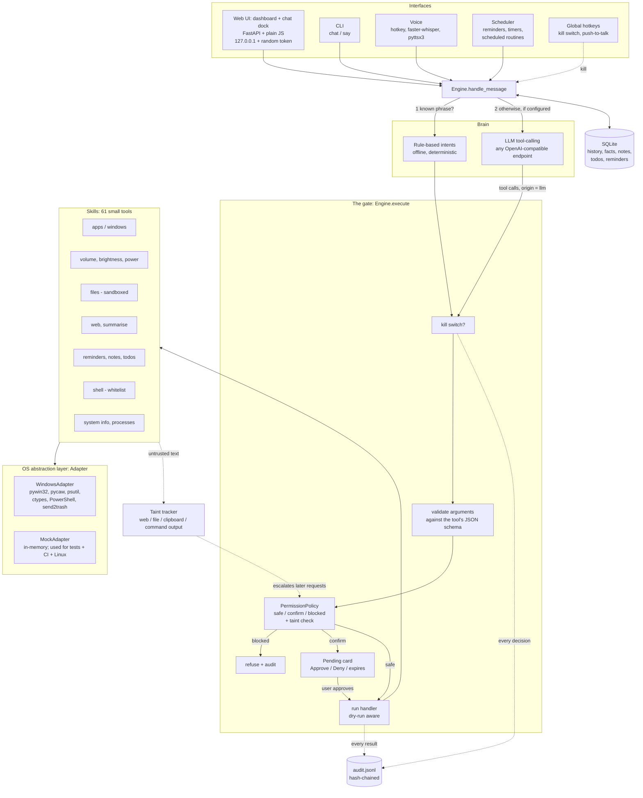

# Delta: architecture

Delta is a small local program with one rule: **every action, no matter who asked for it, goes through one gate.**
The user (typed or spoken), the rule parser, the LLM, a routine and the scheduler are all just *requesters*.



## Modules

| Module | Responsibility |
|---|---|
| `delta/engine.py` | `handle_message` (confirmations, rules, LLM), `execute` (the gate), `resolve` (approve/deny), kill switch, routines |
| `delta/safety.py` | `PermissionPolicy`, `Sandbox`, shell classifier, secret redaction, injection detection, `wrap_untrusted` |
| `delta/registry.py` | `Tool` (schema, level, flags), argument validation |
| `delta/intents.py` | Deterministic phrase → tool parser (works with no LLM, no internet) |
| `delta/brain.py`, `delta/llm.py` | OpenAI-compatible tool-calling loop; system prompt; secret redaction of tool results |
| `delta/adapters/` | `Adapter` interface, `WindowsAdapter` (real), `MockAdapter` (tests) |
| `delta/skills/*.py` | One module per area; each registers `Tool`s |
| `delta/audit.py` | JSONL log with SHA-256 hash chain |
| `delta/memory.py` | SQLite storage; refuses to store secrets |
| `delta/scheduler.py`, `delta/routines.py`, `delta/timeparse.py` | Reminders/alarms, YAML macros, time parsing |
| `delta/server.py` | Local API: token / Host / Origin checks, CSP, chat, confirm, kill switch, assets |
| `delta/dashboard.py`, `delta/ui/static/` | Dashboard API (vitals sampler, widgets, quick actions) and the UI (`index.html`, `dashboard.css`, `dashboard.js`, bundled Geist fonts) |
| `delta/voice.py`, `delta/hotkeys.py` | Optional voice and global hotkeys |

## The dashboard and the gate

The dashboard is a *requester* like any other, never a shortcut:

* **Read endpoints** (`/api/vitals`, `/api/processes`, `/api/files/recent`, `/api/activity`, ...) only read from the adapter, SQLite, the audit log or the config, so they are not audited per poll.
* **Write endpoints** (`/api/actions/*`, `/api/todos`, `/api/reminders`, `/api/routines/{name}/run`, `/api/files/open`, ...) map to a fixed whitelist of tools and call `Engine.execute` / `Engine.run_routine` with `origin="user"`. They get validation, the permission decision, confirm cards (`/api/confirm`), dry-run, the kill switch and the audit entry for free. There is no endpoint that takes a tool name from the browser.
* **Live updates** are polling: a 1 s background `VitalsSampler` keeps 60 samples; the page polls vitals every 2 s and the rest every 3-8 s (paused while the tab is hidden).
* **Page security**: scripts only from `'self'` (no inline script), fonts and styles from `'self'`, no `connect-src` beyond the app, all API text inserted with `textContent`, assets served from a fixed whitelist behind the same token cookie.

## Vibe Coding (`delta/vibe/`)

A separate package that talks to the rest of Delta only through the gate:

* `pathsafe.py` (path jail, names, root check) · `difftools.py` (unified diffs and a tolerant patch applier) · `gitops.py` (snapshot / reset via `git` subprocess) · `templates.py` · `commands.py` (tokenise, whitelist classify, PATHEXT / `npm.cmd` / `Code.exe` / `py -3` resolution, process-tree kill, `Job`) · `preview.py` (static server with error reporter, node / python servers, health) · `manager.py` (projects, per-project JSON state, the staged-change overlay, runs, undo) · `agent.py` (LLM loop, model-name to gate-tool table, taint scan, approval waits) · `fallback.py` (offline rules) · `tools.py` (13 gate tools, category `vibe`, none exposed to the chat LLM) · `api.py` (`/api/vibe/*`).
* **Flow of one run:** `POST /runs` → thread → git snapshot → `AgentRunner` loop → each model tool call → `Engine.execute("vibe_*", origin="vibe", tainted=run.tainted)` → validate → permission (`run_command` classified per call) → handler. Writes only *stage* a `Change`; the dashboard's Accept button calls `vibe_review_change` (`origin="user"`) which writes the file. A command that needs approval returns a pending card; the agent thread waits **outside** the engine lock and resumes when `/api/confirm` resolves it.
* **Why polling:** the run object is a plain thread-safe log (`steps` with ids); the UI asks `GET /runs/{id}?since=n`. It keeps the server free of long-lived connections, the CSP strict (`connect-src 'self'`), and is easy to test, at the cost of ~0.7 s latency and no token streaming.
* **Preview isolation** is described in SAFETY.md §9. The project state (history, convo, auto-accept) lives in `data_dir/vibe/<project>.json`; the files and the git history live in the project folder.

## A request, step by step

1. **Message arrives** (UI/CLI/voice). The text is logged (first 80 characters only) and stored in history.
2. **Pending approvals first.** "yes"/"no" only ever come from the user's own input. A request that was created after Delta read untrusted text (*tainted*) rejects a bare "yes": it needs the button or `yes <id>`.
3. **Rules.** `intents.parse_commands` maps known phrases to tool calls, so common commands are instant, offline and predictable.
4. **LLM (optional).** If no rule matched and an LLM is configured, `Brain.run_turn` runs a tool-calling loop (max 6 steps). Tool results are redacted for secrets, and text from the web/files/clipboard/command output is fenced as `UNTRUSTED_CONTENT`.
5. **The gate** (`Engine.execute`) validates the arguments, asks `PermissionPolicy` for **safe / confirm / blocked** for *this exact call*, then refuses, creates an approval card, or runs the handler. Dry-run mode simulates side-effecting tools.
6. **The adapter** performs the OS call (or the mock records it).
7. **Audit.** Every decision and result is appended to `audit.jsonl`.

## Design decisions

* **Rules first, LLM second.** Core commands never depend on a model, an API key or internet. The LLM adds free-form requests, not the basics.
* **One gate, many requesters.** There is no code path from the LLM, a routine or the scheduler to an adapter that skips validation, permissions, dry-run and audit. A test (`test_routines`, `test_injection`) exists for each requester.
* **The OS layer is an interface.** Skills never import `pywin32`/`pycaw`. The same 439 tests run against `MockAdapter`; the Windows adapter is a thin, separately reviewable file whose only job is to make those calls real.
* **Permission is per call, not per tool.** `open_app chrome` is safe but `open_app unknown.exe` asks; `open_path notes.txt` is safe but `open_path setup.exe` asks; `run_command ipconfig` is safe but `run_command notepad` asks; `kill_process csrss.exe` is blocked.
* **No ambient authority for untrusted text.** The LLM that summarises a web page is called **without tools**. After any untrusted text is read, taint-sensitive tools (open URL, web search, clipboard write, move/copy, remember, run command/script, sleep, routines) need approval for the next few turns.
* **Tamper-evident audit.** Each line stores the hash of the previous one. This detects edits and deletions of single lines; it does not stop someone who can rewrite the whole file (see SAFETY.md).
* **Secrets are never stored.** `remember …` refuses passwords/keys/PINs/cards; the API key lives only in an environment variable; secret-looking text is redacted from the audit log and from text sent to the LLM.

## Adding a skill

```python
# delta/skills/mytool.py
from ..registry import Tool, ToolRegistry, obj, ok, S

def say_hello(ctx, name: str):
    return ok(f"Hello {name}!")          # use ctx.adapter for anything that touches the OS

def register(reg: ToolRegistry):
    reg.register(Tool("say_hello", "Greet someone.", obj({"name": S}, ["name"]), say_hello))
    # level=Level.CONFIRM for anything destructive; always_confirm=True if config must never lower it;
    # untrusted_output=True if it returns text from outside; taint_sensitive=True if it could leak data.
```

Add the module to `delta/skills/__init__.py`, add an intent pattern in `delta/intents.py` if you want a phrase for it,
and add tests using the `eng` / `adapter` fixtures. A new adapter method goes in `adapters/base.py` (abstract),
`mock.py` and `windows.py`.
